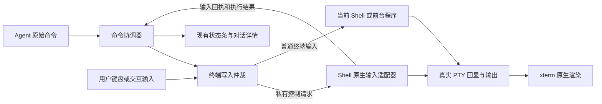
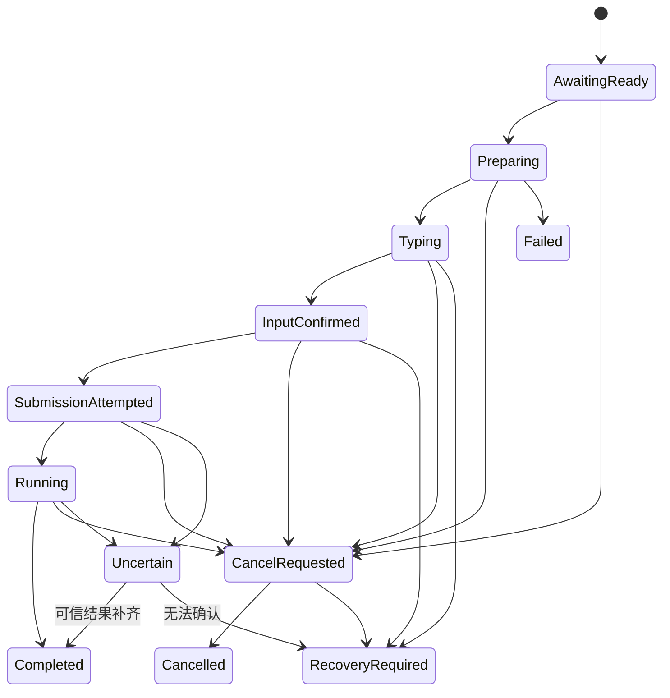

# Agent 原生终端命令输入重构实施方案

**当前执行约束（2026-11-02用户更新）**：保留已有进度，先完成P3、P4代码实现，每阶段仍使用独立会话。
期间只做无界面的编译、类型和静态检查，不启动App、不抢占桌面焦点、不运行模型或真实平台验收。
P3代码交接后可进入P4代码实施，不把平台未验收写成通过，也不启用未验收生产路径。
代码收口后停止，交付修改说明和统一待验清单；下文真实运行验收及阶段退出条件留到后续统一执行。
此顺序调整不改变原生行内体验、权限/审批/目标绑定、用户配置及禁止未知提交重放等边界；不提交、推送或发布。

原生App验收入口默认拒绝启动。只有用户明确安排统一前台验收后，才可为该次命令临时设置
`SHELLSPAN_ALLOW_FOREGROUND_TESTS=1`；不得写入用户配置、默认脚本或用它绕过当前“仅代码/静态检查”约束。
正常产品App启动不受此测试入口保护影响。已有冻结副本未被改写，不能执行其旧入口绕过保护。

状态：用户已明确授权正式采纳通用 xterm 光标/复制修复和同流显示机制；**P0、P1 在冻结的 macOS arm64、GNU Bash 5.3 / Readline 8.3.6 组合上限定通过**。P2 已完成本地 PTY、受控 SSH 与实际 registry 接入；冻结 Bash 生产快照的42/42个必需组合和3/3个生命周期场景，以及SSH故障、交互凭据门禁、委派、争用和关闭补验通过。最后的私有Zsh stty兼容性修复单独通过真实压力、13项NIP和2项检查点回归，未将旧Bash镜像当作该修复版本的全矩阵。P2在审计列明的源码及平台范围内完成；原完整入口与失败轮次保持FAIL，不宣称一次完整入口全绿。P3代码已交接、平台验收未完成；P4代码已实施并完成限定编译/静态收口，动态统一验收未完成。xterm 6.0.0 已通过 pnpm 正式补丁安装。普通原生编辑仍按默认 false 的实际状态/复制兼容性验收，无换行源码等值仅是更强诊断。更新日期：2026-11-02。P4代码范围与待验清单见 [P4审计](agent-terminal-input-p4-audit.md)。当前证据见 [P2 审计](agent-terminal-input-p2-audit.md) 与 [P3 审计](agent-terminal-input-p3-audit.md)；全量门禁中的既有失败见 [P0 可行性报告](agent-terminal-input-native-feasibility.md) 与 [P1 状态审计](agent-terminal-input-p1-state-audit.md)，本阶段通过不代表发布检查全绿。

本方案保留命令在终端行内输入、输出紧接其后、用户随时停止并接管的体验。原始命令的编辑、回显、光标和输入动画由 Shell 原生编辑器负责；前端只渲染真实 PTY 数据和展示结构化状态。

实施从 P0 原生可行性验证开始。Bash 原生适配扩展是候选实现，尚未证明能覆盖全部目标 Bash 构建。P0 未通过前，不启用新的生产执行路径，也不删除当前输入实现。

本方案只涉及终端命令输入及必要的协议、状态、测试和接管逻辑，不重新设计工作台、AI 对话、SFTP 或其他页面。本文中的新模块、类型、接口和脚本均为实施任务，不表示已经存在。

## 1 产品目标与固定边界

### 1.1 保留的体验

1. Agent 在当前绑定的终端输入原始命令，用户可以看到连续输入过程。
2. 输入文字、光标、换行和滚动属于同一条原生终端数据流。
3. 命令执行后，真实输出继续显示在同一个终端中。
4. 用户通过现有停止和接管入口获得终端控制权。
5. 原始命令与真实输出可以回看、选择、复制和搜索。
6. 减少动态效果时直接完成输入；普通用户输入、TUI 和交互程序保留原生行为。

不新增独立命令输入区、覆盖终端的假输入层或第二个命令光标。若原生验证表明必须改变这项产品选择，应提交具体证据和调整建议，由用户决定后再实施。

### 1.2 不可破坏的执行约束

- 当前终端仍是冻结的本地 PTY 或 SSH PTY，不额外创建 Agent 专用 Shell 或终端标签。
- 保留当前目录、环境变量、函数、别名、退出状态、信号和历史配置语义。
- 保留权限、审批、风险分类、冻结目标、角色范围和审计规则。
- 不把编辑回调中的函数内 `eval` 当作父 Shell 顶层执行的等价替代。
- 不把输入动画、前端就绪消息或 OSC 标记当作执行授权。
- 不根据普通输出中的提示符、命令文本或完成字样判定执行结果。
- 提交可能送达后，不自动重放命令或再次发送 Enter。
- 保留真实输出字节；程序自己打印包装命令、提示符或控制标记时，仍按真实输出处理。
- 不为清理视觉历史而删除、覆盖或重放已有输出。超长输入的滚屏行为需与原生编辑器基线对照验收。

## 2 当前实现与重构对象

以下是当前源码入口，不是新架构已经完成的证明。实施时重新冻结代码、依赖版本和工作区差异。

| 当前入口 | 当前承担的相关职责 | 重构安排 |
| --- | --- | --- |
| [terminal_execute.rs](../../src-tauri/src/agent_runtime/native/terminal_execute.rs) | 输入准备、原生帧、回执等待、执行提交、取消和接管 | 保留入口，逐步委托给命令协调器和 Shell 适配器 |
| [terminal_lease.rs](../../src-tauri/src/agent_runtime/native/terminal_lease.rs) | 控制权、所有者校验、就绪和阶段事件 | 明确与 Broker 的权威边界，避免重复维护输入所有权 |
| [terminal_broker.rs](../../src-tauri/src/terminal_broker.rs) | 终端代次、输入准入、命令状态、输出和回执 | 保留传输及写入仲裁职责；逐步统一命令状态归属 |
| [terminal_integration.rs](../../src-tauri/src/terminal_integration.rs) | Bash/Zsh 集成、私有控制和原生编辑器协作 | 拆分各 Shell 适配实现，承接原生行内回显 |
| [PSReadLine 集成](../../src-tauri/resources/powershell/PSReadLine/2.4.5/ShellSpan.PSReadLine.psm1) | PowerShell 原生编辑器集成 | 独立适配和实机验收，不套用 Bash 实现 |
| [terminal-controller-layer.tsx](../../src/components/terminal/terminal-controller-layer.tsx) | 终端选择、焦点、就绪与输入控制协调 | 只负责界面条件和结构化状态，不维护另一套执行状态 |
| [agent-terminal-lease-state.ts](../../src/components/terminal/agent-terminal-lease-state.ts) | 前端 lease 视图 | 迁为后端快照的派生视图 |
| [terminal-registry.ts](../../src/components/terminal/registry/terminal-registry.ts) | xterm 生命周期、输出写入、布局及控制器 | 保留真实终端职责，移除本功能的内部渲染改写 |
| [terminal-command-source.ts](../../src/components/terminal/registry/terminal-command-source.ts) | 原始文字投影、缓冲行与光标替换、选择映射 | 新实现验收后移除 |
| [terminal-command-redraw.ts](../../src/components/terminal/registry/terminal-command-redraw.ts) | 输入清行期间的前端绘制保护 | 新实现验收后移除该输入补丁 |
| [terminal-command-typing.ts](../../src/components/terminal/registry/terminal-command-typing.ts) | 前端逐帧文字展示 | 新实现验收后移除 |
| [terminal-command-decorations.ts](../../src/components/terminal/registry/terminal-command-decorations.ts) | 命令范围和背景标记 | 仅保留公共 API 可实现的只读装饰 |

当前风险集中在同一段输入同时具有原始源码、执行包装、原生编辑缓冲区和前端投影四种表示。替换文字还会影响光标、宽字符、清行、滚动、复制和搜索。重构不再由前端协调这些表示之间的单元格映射。

当前 `TerminalCommandState::Submitted` 的使用范围早于实际可执行提交，旁边还存在独立的 `submitted` 标志。迁移时必须列出所有读写点，不能只重命名枚举就认为提交边界已经统一。

当前协议仍以 [terminal-protocol-rfc.md](../../protocol/agent/runtime/terminal-protocol-rfc.md) 和 [terminal-command-presentation.md](../../protocol/agent/runtime/terminal-command-presentation.md) 为准。[历史首版设计](agent-visible-terminal-execution.md)只作背景，不覆盖当前已支持的交互程序或后台任务。

## 3 目标架构与模块职责



### 3.1 命令协调器

协调器持有一个操作的命令意图、执行计划、生命周期、提交记录和恢复状态。它申请输入所有权、调用 Shell 适配器、处理可信回执，并向前端发布安全快照。

建议在现有 `agent_runtime/native` 领域下组织 `terminal_command` 模块，内部拆分 `intent`、`plan`、`coordinator`、`state`、`protocol` 和 `adapters`。先通过现有执行入口委托调用，不一次性重写整个 Agent Runtime。

命令协调器不直接处理像素坐标，不扫描终端文字，也不绕过 Broker 写入终端。

### 3.2 终端写入仲裁

输入所有权由一个后端权威来源维护，优先沿用 Broker 的输入准入边界。协调器申请、续用、撤销和归还所有权，不另存一份可独立修改的所有权状态。

现有 Agent turn、父子角色和接管后禁止继续写入的规则保持有效。新操作 ID 不能绕过同一 turn 已被接管的限制。

普通键盘、Agent 命令、交互程序输入和系统中断都必须经过统一准入，具有明确的输入来源。共享同一传输，不代表这些输入具有相同权限。

### 3.3 Shell 原生输入适配器

适配器负责能力探测、草稿准备、原生输入推进、完整输入确认、受保护的提交、清除草稿和中断协作。

建议接口职责如下，名称由 P1 冻结：

| 操作 | 作用 | 不得产生的副作用 |
| --- | --- | --- |
| `probe` | 探测当前连接和编辑器能力 | 不执行用户命令、不修改用户配置 |
| `prepare` | 接收不可变源码和输入配置 | 不提交执行 |
| `beginInput` | 原生编辑器开始推进草稿 | 不接受执行包装作为普通可见编辑内容 |
| `confirmInput` | 确认完整源码及其版本 | 不以普通 stdout 替代回执 |
| `commit` | 对绑定计划进行一次可执行提交 | 不自动重试不明提交 |
| `cancelDraft` | 清除本次拥有的未提交草稿 | 不清除用户原有草稿 |
| `interrupt` | 中断绑定的已提交操作 | 不扩大到无关进程或其他操作 |
| `query` | 查询当前已知状态 | 不重新执行命令 |

阻塞读写、文件和 SSH 操作继续在现有后台任务中执行，不阻塞 Tauri 主线程。原生编辑器 API 只能在编辑器所属线程调用。

### 3.4 前端终端与状态视图

终端控制器仅接收真实 PTY 数据、传递用户输入、处理布局与焦点。状态层消费后端快照，驱动现有“输入中、执行中、停止并接管、需恢复”等反馈。

高亮等装饰只使用 xterm 公共 marker、decoration 或只读 parser hook。标记丢失时允许不显示装饰，不允许影响输入授权、输出或执行状态。

新命令展示模块不得读取 `_core`，不得替换 `getLine`、选择、搜索、渲染器方法或内部光标。该约束只针对本次功能，不顺带改造仓库其他终端兼容代码。

2026-10-31 用户正式授权的例外是已验证的**通用终端库规则修复**与同流显示机制：通过 pnpm 维护 xterm 原始源码/运行构建补丁，不是业务层 API 覆盖或文字投影。复制修复也影响默认配置的历史输出。显示模块只提供显式接入，线上 binding 与能力协商由 P1 冻结；当前 registry 没有安装新 handler 或新命令写入路径。

## 4 数据模型与身份绑定

### 4.1 不可变命令意图

`CommandIntent` 至少绑定原始源码、源码摘要、冻结目标、Agent/task 身份和现有审批上下文。源码经过现有校验和审批后，在同一操作中保持不变。

输入的逐字增长是同一源码的应用进度，不是反复创建新的源码版本。源码内容或目标发生变化时，必须重新进入现有校验与审批流程。

### 4.2 后端执行计划

`ExecutionPlan` 保存 Shell 类型、实际提交表示、原始源码摘要、计划摘要、执行方式和必要的提交前置条件。执行包装只属于后端及受控原生适配器，不作为前端绘制依据。

最终确认不能只比较界面文字。适配器必须将确认的原始源码、准备的执行计划和即将使用的提交方式绑定起来，保留当前完整提交校验的强度。

### 4.3 操作身份

| 字段 | 含义 | 校验规则 |
| --- | --- | --- |
| `terminalSessionId` | 绑定的逻辑终端 | 不从当前选中的页面临时推断 |
| `terminalGeneration` | 终端传输代次 | 重连后旧代次失效 |
| `operationId` | 本次命令操作 | 沿用经过校验的不透明标识，不强制改变现有 ID 格式 |
| `leaseGeneration` | 输入所有权代次 | 接管或转移后旧写入失效 |
| `sourceRevision` | 本次不可变源码版本 | 所有准备、回执和提交一致 |
| `planDigest` | 准备的执行计划摘要 | 仅在后端及私有控制协议使用 |
| `requestId` | 一次控制请求的标识 | 用于匹配回执和拒绝重复请求 |

执行沿用 Broker 当前终端代次，不能再引入一套含义重叠、彼此独立递增的连接代次。

### 4.4 前端安全快照

前端 DTO 至少包含操作身份中的公开部分、快照序号、生命周期、是否可能已经提交、可采取的安全操作及脱敏命令展示文本。

原始源码摘要、执行包装及秘密内容不因展示需求而扩大到前端事件或普通日志。`displaySource` 与执行源码经过脱敏后长度可能不同，不能直接把原始字节偏移作为展示字符偏移。

原生输入进度在私有协议中明确单位。字节数使用 UTF-8 字节，字素数指完整 Unicode 字素，不使用含义不明的 `offset`。若无法安全映射到脱敏展示文本，前端只显示阶段状态，不展示虚构的字符进度。

## 5 生命周期与提交边界



### 5.1 状态含义

| 状态 | 进入依据 | 用户界面含义 |
| --- | --- | --- |
| `AwaitingReady` | 目标已冻结，等待所有准入条件 | 正在准备终端 |
| `Preparing` | 已取得所有权，原生适配器接收和校验草稿 | 正在准备命令 |
| `Typing` | 原生编辑器开始应用源码前缀 | 正在输入命令 |
| `InputConfirmed` | 完整源码和计划确认完成 | 输入完成，尚未提交 |
| `SubmissionAttempted` | 可执行提交将要投递或可能已投递 | 已尝试提交，不能再保证未执行 |
| `Running` | 收到绑定操作的可信开始回执 | 正在执行 |
| `Completed` | 收到可信结束结果 | 已结束，单独显示退出码与结果 |
| `CancelRequested` | 取消或接管请求已使旧写入失效 | 正在停止或接管 |
| `Cancelled` | 收到对应阶段的停止确认 | 已停止；仍保留是否曾提交的信息 |
| `Failed` | 能证明未提交的准备或校验失败 | 未执行，说明失败原因 |
| `Uncertain` | 可能已提交，结果缺少可信确认 | 执行结果不明，不自动重试 |
| `RecoveryRequired` | 输入状态或控制权无法安全恢复 | 需要明确恢复操作 |

非零退出码不等于“没有执行”。停止后的结果必须记录是未提交取消，还是已执行后中断。状态图只描述主要路径，P1 的转换表还须列出连接关闭、能力丢失和应用退出事件的处理。

### 5.2 就绪条件

同时检查冻结目标与代次、后端输入所有权、角色和审批条件、原生 Shell 就绪回执、用户待编辑草稿、未确认用户提交、凭据提示，以及当前要求的前端连接、订阅和焦点条件。

前端就绪仅证明界面条件，不代替后端授权或 Shell 就绪。不得把 `term.write` 的回调、一次渲染或提示符文本视为执行条件。

### 5.3 单次提交

提交必须由协调器唯一入口完成：

1. 核对身份、所有权代次、完整源码确认和执行计划。
2. 重新执行现有提交前权限、目标、期限和取消检查。
3. 建立可恢复的提交意图记录，保护应用崩溃后的不重放规则。
4. 在同一个写入准入边界中再次检查取消与所有权，并登记提交可能发生，再投递一次 `commit`。
5. 等待可信结果；本地入队成功、SSH 写入成功或界面更新都不代表已经执行。

审计持久化与写入的先后关系必须经过崩溃测试。持久化后、真正投递前的崩溃可以保守地进入不确定状态，不能为了给出确定答案而自动重放。不得跨磁盘或网络回执等待持有终端全局互斥锁。

协议不承诺跨进程崩溃和网络断连的无条件 exactly-once。要求是同一操作不重复自动提交，结果不明时保持不确定，并通过查询或明确恢复处理。

## 6 私有控制协议

### 6.1 版本与能力

使用显式能力协商区分 `native-inline` 和 `raw`。旧投影模式及旧客户端兼容已经移除；能力与身份仍按NIP/1和实际资源校验。

`native-inline` 至少要求原生源码回显、原子提交交接、完整输入回执、草稿取消恢复和对应的控制身份校验。不能仅凭 Shell 名称或版本推定能力。

### 6.2 消息语义

| 请求或事件 | 关键内容 | 结果 |
| --- | --- | --- |
| `Capabilities` | Shell、编辑器、适配器版本和已验证能力 | 确定本连接可用模式 |
| `PrepareInput` | 操作身份、完整源码、计划绑定、输入配置、期限 | 接收草稿，不执行 |
| `Prepared` | 绑定的请求和源码确认 | 允许开始原生编辑 |
| `InputProgress` | 已应用源码前缀及明确单位 | 仅用于观察，可合并 |
| `InputConfirmed` | 完整源码与计划绑定证明 | 允许协调器进行提交检查 |
| `Commit` | 绑定同一计划的单次请求 | 跨越可执行提交边界 |
| `Started` 和 `Settled` | 可信的开始、结束、退出状态和停止结果 | 推进执行状态 |
| `CancelDraft` 和 `DraftCleared` | 本次草稿及其清除证明 | 归还未提交的终端 |
| `Interrupt` 和 `Query` | 已提交操作身份 | 受控中断或只读查询 |

所有有状态请求和回执校验身份、请求标识、大小上限及期限。拒绝旧代次、过期、重复提交和不匹配的源码版本。普通 stdout 中相同的消息文本不具有控制效力。

### 6.3 传输与解析

优先复用现有受控私有通道。若完整草稿传输需要双向能力，应明确扩展该通道，不把 JSON、编码脚本或执行包装混入可见命令行。

使用成熟的有界帧解码和序列化依赖。P1 冻结报文上限、部分帧处理、EOF、背压、期限和错误码；源数据大小限制先沿用现有约束，不能借重构扩大输入范围。

私有端点沿用最小文件权限、临时目录和清理策略；原生扩展新增的控制描述符不得泄漏给执行的子程序。协议仍需校验对端数据，不能将目标端回执升级为客户端审批权限。

### 6.4 状态事件与快照

前端使用带单调序号的完整安全状态快照，或者能够通过读取快照补齐的事件。旧代次和旧序号直接丢弃。进度可合并，开始、结束、所有权撤销及恢复状态不能被进度合并覆盖。

PTY 字节流和状态通道各自保持顺序，不假设两个通道按相同时间到达。终端继续处理真实输出，状态视图可以读取快照追上；不得为等待界面动画或元数据而阻塞 PTY。

## 7 各 Shell 的原生输入策略

### 7.1 Bash

候选实现是小型 Readline 原生适配桥接，使用经过核实的原生编辑、回显及接受输入接口。加载方式、目标符号可用性、线程约束和提交后的最后一次重绘都属于 P0 验证内容。

编辑阶段，真实编辑草稿是原始源码前缀。若实际执行需要包装，原生适配器在受保护的提交交接中绑定并处理包装；不得让包装重新进入普通可见编辑回显。对接收、输入、确认、提交和恢复的每个入口建立明确的所有权检查。

不能只把重复 `bind -x` 调用移到别的函数。新机制必须证明不再因每个输入批次等待网络数据而重复清除和恢复整段命令。若需要原生扩展，P0 报告同时确认构建、分发、完整性校验、依赖许可和适用构建范围。

原生扩展不能调用未经验证的内部 Bash 符号来勉强完成目标。若必须依赖非稳定接口，需要先提交兼容性结论，不能直接推广为通用支持。

### 7.2 Zsh

使用 ZLE 的原生 widget、BUFFER 和接受输入机制，独立验证提交时的最终重绘。保留用户已有提示符、着色、函数和配置，不将 Bash 的具体实现平移到 Zsh。

重点验证自定义提示符、窄窗口、超长输入和后台任务通知。保留真实输出，不通过反复重放整个屏幕恢复提示符。

### 7.3 PowerShell

沿用受控 PSReadLine 集成，在同一绑定终端和既有执行上下文中完成适配。前台命令、当前已支持的后台执行方式和停止机制分别保持现有语义。

Windows PowerShell 5.1 与 PowerShell 7 必须分别在 Windows 实机验收。macOS 或 Linux 的 Bash 结果不能覆盖这项验收。

### 7.4 能力不满足时

保持普通 SSH/Shell 连接可用，明确报告原生行内输入能力不可用或需要恢复。不得静默切换 Direct、另开 Shell、扩大权限、关闭用户配置或自动重新提交命令。

连接仍然可用，不表示未知草稿已经清除。活动输入状态不明时继续保留恢复门禁，不能仅因私有通道断开就向用户开放可执行输入。

旧会话如何继续使用旧实现由迁移阶段控制；原生能力不可用不能成为新增前端缓冲区替换的理由。

## 8 打字机输入与几何变化

完整草稿经私有通道准备后，由目标端原生编辑器调度输入，避免每个字素进行一次 SSH 往返。原生编辑器更新草稿并正常回显，前端不生成另一条动画文字流。

字素分段使用成熟 Unicode 依赖。字符宽度、光标和换行由原生编辑器与 xterm 在经过验证的 Unicode/locale 配置下处理，业务代码不再自算像素或终端列宽。

输入动画预算先以现有约 1.7 秒上限目标为基线，在 P0 测量后冻结。长命令按剩余时间调整每次应用的字素数量，不能为逐字符确认追加无限等待。动画预算与网络、命令执行期限分别定义。

减少动态效果时直接应用完整草稿。无论是否有动画，提交都要求完整输入回执和既有提交检查，不等待前端发送动画完成消息。

终端大小由现有布局和 ResizeObserver 驱动。准备输入时确认适配器可用的几何信息；输入期间缩放由原生编辑器处理，并重新确认必要的编辑状态。几何变化不得修改源码、放宽提交检查或重置命令总期限。

网络和终端可能合并绘制帧，不将每个字素必定单独出现作为跨网络保证。要求是文字、光标与原生流一致，未绘制某个中间帧不改变执行状态。

## 9 取消 接管与恢复

| 发生位置 | 必须执行的动作 | 允许的结束结果 |
| --- | --- | --- |
| 等待就绪 | 撤销请求，不发送命令内容 | 未执行取消 |
| 草稿接收或输入中 | 撤销后续写入，清除本次拥有的草稿并确认 | 未执行取消；清除不明则需恢复 |
| 完整输入已确认 | 与提交使用同一准入边界竞争 | 撤销成功则不提交；提交先发生则按已提交处理 |
| 提交请求可能送达 | 禁止重放，查询或发起受控中断 | 已执行、已中断或结果不明 |
| 正在执行 | 对绑定操作使用既有受控中断和结束确认 | 带停止结果的结束；不能确认则不确定 |
| 控制通道断开 | 原生适配器停止推进，阻止未确认提交，恢复可证明安全的编辑状态 | 已知清除或需恢复 |
| 终端断开 | 使旧代次和排队写入失效 | 未提交取消或提交后结果不明 |
| 应用退出或崩溃 | 恢复依据持久提交边界与可信查询 | 不自动重放命令 |

接管先撤销旧输入所有权代次，使排队写入和迟到回调失效，再按上述阶段处理。释放 lease 事件不等于“编辑器为空”或“进程已经停止”，这两项必须有各自证明。

原生适配器只能清除本次拥有且能够确认身份的草稿。用户原有草稿、未知编辑内容及凭据提示不能自动清除。

密码、交互程序输入与 TUI 继续走其专用路径。进入全屏程序后，命令输入适配器不接管程序的缓冲区或光标。

## 10 输出 历史与敏感内容

1. PTY 原始输出不因命令美化而过滤或重写。既有敏感信息保护边界继续有效，不新增绕过脱敏的“原始日志”。
2. Agent 工具结果继续由既有可信捕获边界提取；输入和执行输出的分界不再从文本相似度推断。
3. `combinedOutput`、退出码和执行状态保持现有契约，不将执行计划或内部元数据当作空输出的替代内容。
4. 终端选择、复制和搜索来自 xterm 原生缓冲区，不再维护单独的文本版本。
5. Shell 的 history 设置不能为展示效果被静默修改。最终历史条目是否保留包装、是否能准确记录原文，应在 P0 逐项验证并形成兼容性结论。
6. 密码、私钥、token 等沿用凭据引用和专用输入机制，不进入命令展示、普通配置、日志或回归截图。
7. 记录有排障价值的操作身份、状态转换、错误码与必要耗时；不记录逐字进度、原始私有报文或每帧对象转储。

## 11 分阶段实施任务

所有清单初始为未完成。每阶段必须记录冻结代码、验证范围、实际结果和未覆盖项，阶段通过不代表全部平台通过。

### P0 原生可行性验证

**进入条件**：已阅读当前协议、执行与接管实现；已冻结基线和受控测试环境。

- [x] 列出当前 Bash、Readline、Zsh、PSReadLine 的兼容承诺与实际可用测试环境。
- [x] 建立可复现的 Bash 原生桥接原型，验证加载、符号、回显、最终提交和恢复。
- [x] 在没有前端文字投影、假光标或输出过滤的条件下，运行短、长、多行和 Unicode 输入。
- [x] 验证源码与提交包装的绑定，录制最终提交前后的真实 PTY 字节与画面。
- [x] 验证父 Shell 状态、退出码、信号、history 和用户配置语义。
- [x] 验证输入前、输入中、确认后、提交瞬间和执行中取消与接管。
- [x] 验证后台输出、动态缩窗、控制通道 EOF 和回执迟到；初轮失败保留，正式 pnpm 包 + 同流显示完整组合在冻结目标上通过。
- [x] 写入 `agent-terminal-input-native-feasibility.md`，给出可支持的构建范围与通过或阻塞结论。

**交付**：原型源码、构建方法、真实测试入口、原始证据、兼容矩阵、恢复过程和结论。

**退出条件**：在冻结的 Bash 目标上证明原位输入、包装不泄露为内部回显、原生光标正确、执行语义不变及异常可恢复。未通过时不能进入生产切换，应保留证据并调整设计。

本次限定通过沿用授权前最新报告的完整冻结组合：macOS arm64、GNU Bash 5.3 + 静态 Readline 8.3.6、默认 emacs/INT、受控 HOME/locale/提示符、正式 patched xterm 6.0.0。4.1/4.4 的既有低层验证和提交保护证据不等于其新显示扩展已验收；原生产 legacy 支持保留。不外推 Windows、Linux/SSH 新显示扩展、其他架构、用户插件或自定义 signal/input provider。生产能力/标识/恢复仍由后续阶段冻结。

### P1 统一状态和协议

**进入条件**：P0 通过，或仅开展与原生机制无关的状态梳理；后者不能启用新执行路径。

- [x] 盘点命令状态、`submitted` 标志、lease、Broker 准入和前端视图的全部读写点（包括 `submission_attempted`、`source_may_be_enqueued`、持久分发和恢复门禁；见 P1 审计）。
- [x] 明确后端命令状态和输入所有权各自的唯一所有者与顺序：Broker operation lifecycle 和最终 lease 准入；LeaseManager 保留 turn/角色/前端 ready 等独立前置条件。
- [x] 实现不可变命令意图、执行计划、操作身份、完整输入证明和安全快照。
- [x] 定义全部事件的接受/拒绝/幂等条件；P1 初始生成504格，当前含停止未确认事件的验证表为21条状态/事实路径×26事件、546格，见P3审计。
- [x] 实现 SQLite FULL 提交意图、fsync 后重校验、最终单次准入及真实 SIGKILL 重启不重放测试。
- [x] 冻结 NIP/1 版本、真实构建能力、大小、单调期限、错误码与完整快照游标。
- [x] 通过 Rust command、注册、TypeScript 类型及 `src/lib/ipc/tauri.ts` 对齐接口。
- [x] 原状态条复用布局及 i18n，新增阶段键中英文一致，保留现有键盘/焦点与 role=status，不逐字播报。
- [x] 增加状态、权限、旧代次、重复提交、存储故障和真实恢复测试。
- [x] 旧执行器与显式 native 协调器共用 Broker 操作及 submission_gate；native 每操作只能 claim 一次，前端只读投影不能授权输入。

完整实现开始于 2026-10-31，最终验收延续至 2026-11-01。线上契约见 [NIP/1](../../protocol/agent/runtime/native-input-v1.md)，实际结果及基线失败见 P1 审计；实现清单勾选不替代最终门禁结论。应用生产 native 传输、SSH 制品分发和 registry 接入仍留 P2。现有 legacy 支持保留，新路径只在固定 profile 的真实测试显式接入。

**交付**：模块接口、状态转换表、协议 schema、兼容适配及相关测试。

**退出条件**：同一操作只有一个生命周期来源；提交不能被取消或迟到回执跨越；前端状态无法产生执行授权。

P1 已在上述固定 profile 完成这些退出条件。`pnpm test:terminal-input:p1` 的 12 步通过，另补充实际 vi 编辑模式拒绝验证后，最终原生协议 13 项及实际捕获/schema/浏览器复验通过。P2 交接必须保留本文审计中的平台、全量门禁及半包 parser 限制；不能据此提前启用其他构建或退役 legacy。

### P2 Bash 本地及 SSH 迁移

- [x] 接入经过 P0 验证的原生适配器和完整草稿传输。
- [x] 实现目标端输入调度、减少动态效果与完整输入确认。
- [x] 实现受保护的单次提交和独立的结果查询。
- [x] 接入取消、接管、连接代次变化、控制通道失败和关闭清理。
- [x] 保持现有工具名、权限、审批、冻结目标、输出结果和后台任务契约。
- [x] 前端按能力选择 `native-inline`；此路径不安装旧文字投影和动画补丁。
- [x] 在新本地连接及受控 SSH 连接验证，不操作未获授权的真实业务主机。
- [x] 验证旧客户端、旧集成和已有终端实例不会误进入新路径。

**退出条件**：Bash 目标矩阵通过真实 PTY/SSH 和实际浏览器验收；原生路径中不存在 xterm 私有输入渲染改写。

2026-11-01：以上退出条件在 macOS arm64 本地和受控 Linux aarch64/glibc 2.36 SSH 的
GNU Bash 4.1/4.4/5.3 固定 profile 上完成。源码范围、原完整入口 FAIL、独立补验、
Zsh兼容性修复及打包证据见 [P2 审计](agent-terminal-input-p2-audit.md)。
完整入口为 `pnpm test:terminal-input:p2`；不以累计覆盖冒充一次入口通过或其他平台通过。
具备进入 P3 的阶段前置条件，不代表 ZLE/PSReadLine 已实施或已验收。

### P3 Zsh 与 PowerShell 迁移

**最新实施顺序（2026-11-02）**：用户已调整为先完成P3/P4代码、各阶段独立会话，再统一验收。
P3适配器、接入和被动诊断代码已实施，见[P3代码交接](agent-terminal-input-p3-code-handoff.md)。
以下复选框含平台验收条件，保持未勾选；它们不再阻塞P3代码交接及另会话的P4代码实施。
当前仅允许无界面编译/类型/静态检查，不运行App、模型、浏览器或Shell/PTY/SSH实测；
未验收编辑器生产准入继续关闭，不因代码交接而提交、推送或发布。

- [ ] 分别实现并验证 ZLE 与 PSReadLine 适配器。
- [ ] Zsh 验证自定义提示符、着色、后台通知、长输入和本地/SSH 场景。
- [ ] PowerShell 5.1/7 在 Windows 实机验证原生输入、前台与既有后台执行、停止和恢复。
- [ ] 不改变各 Shell 的受支持语义，不将新 Shell 进程当作透明替代。
- [ ] 更新逐平台、逐版本的能力和证据矩阵。

**退出条件**：各平台独立通过；没有实机证据的平台保持未验收，不外推结果。

2026-11-02当前进展：正式 `shellspan.zle-native-append/1` 使用特殊整数参数
`ZLE_NATIVE_APPEND=0/1`，默认0；标准recipe实际Core为Mac `cc7f4263`、Linux `c9e451bd`。
正式xterm patch `dcabd41a`（UMD `48f368b5`）已采用视口及选区坐标修复：56项选区、
8项视口和64项显示回归通过；Mac16/SSH8共24个真实LIVE场景、775历史渲染帧满足各自契约。
Mac当前29c源码的实际registry/Broker启动及CUA有界初始绘制、真实MiniMax七工具模型链通过；
输入后背压旧轮次的焦点失败保留；scratch并发重开竞态已修复，8项相关测试通过。
新完整 `b13af012` 源码的真实SSH ZLE App七工具链路及本地背压新轮次通过；
旧焦点失败尚未定因，未回填为通过；同源可见前缀取消、REPL/TUI与fresh-task凭据门禁、
争用/重试/接管/关闭均完成独立真实App验收。namespace11、EOF14、绑定/路径/默认准入各1场
同源原生边界检查通过；Windows仍无最新实机结果，不将这些限定证据勾为整体阶段完成。
Mac完整App不明提交、迟到Started、禁写与显式新终端恢复已通过限定窗口验收。
Windows目标离线，5.1/7及完整跨平台门槛仍未完成，以上P3复选框保持未勾选；
普通生产编辑器准入仍为空。当前源码、逐轮边界与未覆盖项见[P3审计](agent-terminal-input-p3-audit.md)。

同期GNU显示ABI修订的Mac/Linux各三目标已完成标准构建、实际分发源码独立重建、
36场真实PTY几何、144个浏览器组合及三版本信号/EOF恢复回归；三个GNU SSH App作业场景
也各有独立证据。范围与完整检查的失败见[GNU审计](agent-terminal-input-gnu-display-abi-audit.md)，
不将这些结果作为Windows、全部最新P2 App矩阵或P3/P4完成的证明。

### P4 旧实现退役与收口

按用户最新顺序，由协调会话在P3代码交接后另开本阶段的代码实施会话；统一验收留后。
代码实施与验收结论分开，不删除旧失败证据或启用未验收平台来满足本阶段条件。

- [x] 在已迁移路径删除文字投影、前端打字机、光标替换和输入重绘保护的接入。
- [x] 确认所有目标能力与旧会话策略后，删除不再需要的实现、状态、缓存和测试入口。
- [x] 保留能够表达原始缺陷的真实回归证据，迁移断言，不通过删除测试消除失败。
- [x] 增加针对新命令展示模块的静态边界检查，禁止 `_core` 和公共接口覆盖。
- [x] 更新当前协议、源码入口、测试入口及平台验收文档。
- [x] 完成本轮允许的类型、构建、源码编译及静态检查；全仓格式基线问题单列，详见P4审计。
- [ ] 后续统一执行动态回归及完整检查，核对最终整合源码、资源、实际镜像与平台证据。
- [ ] 形成最终验收报告，逐项列出满足、阻塞和未覆盖项。

**代码状态**：P4代码已收口，未启用生产profile，未做动态验收。原退出条件仍待统一验收：没有同一终端实例中的双写入者或双渲染模型；没有未说明的兼容路径；完成标准全部满足。
 ## 12 测试矩阵与证据要求

### 12.1 环境矩阵

| 维度 | 必须冻结的内容 |
| --- | --- |
| Bash | 现行支持范围内的代表版本；优先核对 4.1、4.4、5.3 及目标部署构建，不视为原生扩展已支持 |
| Zsh | 系统版本、提示符插件及 locale |
| PowerShell | 5.1/7、PSReadLine 版本、Windows/ConPTY |
| 传输 | 本地 PTY、受控 SSH；字节拆分、合并、延迟、EOF 和重连 |
| 字符 | ASCII、中文、组合字符、Emoji/ZWJ、Tab、换行、引号和 `!` |
| 尺寸 | 至少 32、40、100、180 列；输入中缩放与 AI 面板压窄 |
| 渲染 | Chromium/WebKit、DOM/WebGL、现有亮暗主题与焦点状态 |
| 交互 | 用户已有草稿、后台输出、停止、接管、TUI、凭据提示及应用退出 |

### 12.2 行为验收

| 编号 | 场景 | 必须满足的结果 |
| --- | --- | --- |
| T01 | 短命令与长脚本 | 原始命令完整，实际输入与提交各有明确确认 |
| T02 | 最终提交 | 内部包装不作为输入回显重新出现；只发生一次自动提交 |
| T03 | Unicode | 不拆字素，光标、换行与真实原生基线一致 |
| T04 | 输入推进 | 不为每个字符追加 SSH 往返；减少动态效果有效 |
| T05 | 选择和搜索 | 使用原生缓冲区，回看与复制内容一致 |
| T06 | 持续后台输出 | 不丢失、过滤或重放输出；不为重绘清除既有内容 |
| T07 | 程序打印提示符或包装 | 真实输出原样保留，不被识别为可替换输入 |
| T08 | 输入中改变尺寸 | 原生重绘正确，不改变源码或提交次数 |
| T09 | 提交前取消 | 清除本次草稿并确认，不能影响用户草稿 |
| T10 | 提交瞬间接管 | 提交与撤销具有明确先后，不产生迟到可执行写入 |
| T11 | 提交后断线 | 结果保持不明，不能自动重放或宣称未执行 |
| T12 | 控制通道或适配器失效 | 能力撤销，明确恢复，不误归还可写控制权 |
| T13 | TUI 和交互输入 | 不安装命令展示改写，不接管程序光标 |
| T14 | 父 Shell 状态 | `cd`、`export`、函数、`$?`、trap、history 和错误语义保持契约 |
| T15 | 多 Agent 与重连 | 旧代次、旧操作、父子角色和接管限制均生效 |
| T16 | 应用崩溃恢复 | 从提交记录和可信查询恢复，不自动执行第二次 |

普通用户编辑保持原生路径，以默认 `reflowCursorLine=false` 与原库的状态、复制行为及实际执行作回归对照。无 owned 路径参与的普通 Readline 硬换行，不要求 clipboard 等于移除换行后的源码；该更强检查仅是诊断，不增加冻结目标。Agent owned append 的完整可见文本、原生源码绑定、复制与原生 cell 一致及 Tab 合法展开仍是 T05/T08 的硬门禁。通用复制补丁会改变所有符合条件的软换行复制，包括默认配置历史输出，不能以代表性普通编辑一致推导全局行为不变；本次变化已获用户明确授权，不扩大为其他业务层改写。

至少覆盖所有关键状态上的取消、超时、能力丢失及回执不匹配。真实故障可以通过关闭受控通道、改变真实窗口或给真实网络施加延迟来产生，不能伪造“已输入”或“已完成”回执。

### 12.3 证据记录

每轮验收记录：冻结代码与工作区差异、系统/架构/Shell/编辑器版本、依赖、命令、退出码、PTY 和回执证据、必要的截图或录屏、结果及适用边界。

证据必须脱敏。逐帧成功日志、敏感命令明文和完整私有报文不进入业务日志或永久测试输出。

临时原型工程同时从 Git 和正式测试发现中排除，避免重复发现复制出来的测试。可复用测试源代码放在被测代码附近，验证产物存入受控且忽略的目录。

## 13 验证命令与执行顺序

以下为当前已有入口。P0/P1 新增适配器测试脚本时，应同时登记在 `package.json` 和协议文档中，不能把尚未存在的命令写成已经可运行。

先运行与修改直接相关的测试：

```bash
pnpm test:terminal-input:p1
node scripts/verify-terminal-input-p1.mjs --schema-only
pnpm exec vitest run src/components/terminal/__tests__/terminal-command-source.test.ts src/components/terminal/__tests__/terminal-command-typing.test.ts src/components/terminal/__tests__/terminal-registry.test.ts src/components/terminal/__tests__/terminal-controller-layer.test.tsx
cargo test --manifest-path src-tauri/Cargo.toml --lib agent_runtime::native::terminal_execute::tests::
pnpm test:terminal-command-source
pnpm test:terminal-command-presentation
pnpm test:terminal-command-redraw
```

在受控环境运行真实原生与平台验收，具体环境配置沿用对应脚本及现行验收文档：

```bash
cargo test --manifest-path src-tauri/Cargo.toml --lib native_bash_multiline_typing_renders_progress_before_single_submission -- --ignored --test-threads=1
pnpm test:terminal-editors:macos
pnpm test:terminal-visible:ssh
pnpm test:terminal-visible:windows
```

迁移阶段满足相关检查后，再运行完整检查：

```bash
pnpm test
pnpm build
cargo test --manifest-path src-tauri/Cargo.toml
cargo fmt --manifest-path src-tauri/Cargo.toml -- --check
pnpm check:rust:includes
git diff --check
```

运行旧测试的目的是保护基线。P4 删除旧实现时，应先建立替代回归，再更新脚本、文档和检查命令。

无关工作区错误单独报告；可以在保留本次依赖的隔离快照中验证相关改动。不得覆盖其他代码、恢复用户删除的内容、跳过必要检查或把隔离结果称为整个工作区通过。

## 14 发布切换与回退

能力配置在终端 generation 初始化时确定，不热切换正在运行的实例。当前仅有native-inline/raw；旧客户端标识和旧作业输入兼容已经删除。raw终端拒绝Agent源码及作业输入，普通用户终端、TUI和原有输出继续保留；当前原生后台作业仍受原身份与计划校验约束。重连先排空旧输出再建立新代次，不清屏、重放或回填历史。ZLE/PSReadLine生产编辑器profile仍为空，须后续验收并另行准入；GNU Bash继续独立按来源匹配catalogue和实际绑定Shell SHA/模块校验决定原生能力。

发生故障时，先停止受影响连接的新 Agent 输入并按提交边界处理正在进行的操作。不得将可能已经提交的命令切换实现后再执行一次。

回退配置只决定后续连接使用的受支持实现，不重放命令、不擦除终端历史、不重启用户的远端服务。任何超出既有授权的真实主机部署或验收必须另行取得授权。

本方案不自动创建 commit、tag、推送、版本或发布。代码提交和发布仍遵循仓库约定与用户明确指令。

## 15 实施前需冻结的决策

| 决策 | 负责阶段 | 所需结论 |
| --- | --- | --- |
| Bash 原生适配机制 | P0 | 目标构建是否可加载、是否仅依赖可接受接口、如何恢复 |
| 受支持平台和版本 | P0/P3 | 能力矩阵、真实环境与不支持行为 |
| 父 Shell 与 history 语义 | P0 | 与现行契约对照，明确任何差异 |
| 控制通道与报文格式 | P1 | 复用或扩展方式、版本、大小、期限与校验 |
| 生命周期和所有权来源 | P1 | 各字段唯一写入者、合法转换和提交边界 |
| 提交记录与崩溃恢复 | P1 | 持久化与投递的顺序及恢复证明 |
| 动画和 Unicode 配置 | P0/P2 | 原生调度能力、宽度配置、输入预算和实测结果 |
| 新旧会话兼容 | P1/P4 | 单实例单实现、旧历史保留及最终退役条件 |

未冻结的决策不能由实现者用隐式前端补丁、静默 Direct 路由或新 Shell 来代替。通用 xterm 规则与同流机制的正式采纳已获用户明确授权；P1 已分配 `shellspan.native-input/1` 和正式显示 binding，生产接入仍留 P2。

## 16 最终完成清单

- [x] P0 原生可行性验证在上述冻结组合限定范围通过，并明确未验收平台。
- [ ] 生命周期、输入所有权和可执行提交具有唯一且可验证的权威边界。
- [ ] 原始命令、光标、动画和输出由同一原生流呈现。
- [ ] 前端新路径不存在 xterm 私有状态访问或接口覆盖。
- [ ] 一次操作不会重复自动提交，未知结果不被报告为未执行。
- [ ] 取消、接管、断线、能力失效和退出恢复均有真实回归。
- [ ] 真实输出、选择、复制、搜索、TUI 和用户草稿保持契约。
- [ ] Bash 本地及 SSH、Zsh、PowerShell 分别完成约定范围验收。
- [ ] 旧实现和兼容入口按明确条件退役，历史会话不被破坏。
- [ ] 相关测试、构建、格式和协议检查通过，未覆盖项明确列出。
- [ ] 当前协议、模块入口、运行方法和最终验收报告已经更新。

存在未满足的完成项时，报告阶段性成果与阻塞证据，不将整个重构标为完成。

## 17 执行任务入口

可将以下内容作为实施任务的开始指令：

```text
请在 ShellSpan 仓库执行 docs/design/agent-terminal-input-refactor-implementation-plan.md。
先阅读 AGENTS.md，冻结当前源码、工作区差异与相关协议。
从 P0 的 Bash 原生可行性验证开始，未通过不得启用生产新路径。
按 P1 至 P4 逐阶段实施、测试、修正和记录证据，不只交付设计文档。
保留原生终端行内体验；禁止前端缓冲区、光标、选择和搜索改写作为最终方案。
不改无关 UI、执行权限、审批、冻结目标或用户配置。
使用真实 Shell、PTY、SSH 和浏览器验证，明确各平台验收边界。
只有需要新的产品取舍或授权时才提问；不伪造完成、不自动重放不明提交。
未明确授权时，不提交、不推送、不发布，不操作真实业务主机进行有副作用的验收。
```

## 18 参考入口

- [当前终端协议](../../protocol/agent/runtime/terminal-protocol-rfc.md)
- [当前命令展示协议](../../protocol/agent/runtime/terminal-command-presentation.md)
- [终端执行测试矩阵](../../protocol/agent/runtime/terminal-execution-test-matrix.md)
- [终端实现演进与历史验收入口](../../protocol/agent/runtime/visible-terminal-unification-plan.md)
- [xterm IBuffer 公共接口](https://xtermjs.org/docs/api/terminal/interfaces/ibuffer/)
- [xterm parser hook 与异步处理说明](https://xtermjs.org/docs/guides/hooks/)
