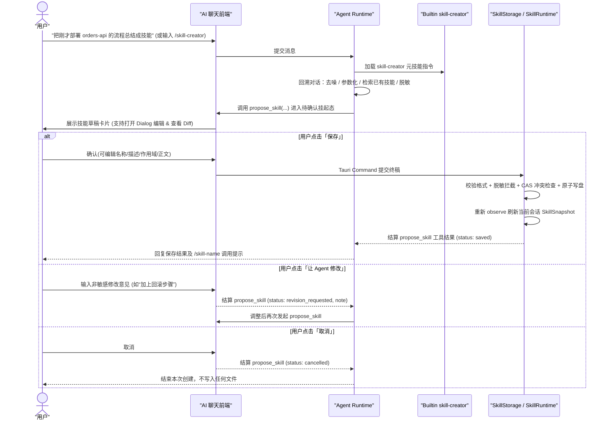

# ShellSpan 聊天创建技能（Chat-to-Skill）与用户全局技能设计方案

> 目标：支持用户在 Agent 对话中将部署、排障、发布等可复用流程快速沉淀为个人技能，默认存储于 `~/.shellspan/skills/`，并在本地与远端 SSH 会话间无缝复用，同时保持 ShellSpan 现有的沙箱、脱敏与人机确认安全边界。

---

## 1. 背景与现状分析

ShellSpan 目前已具备完整的 Skills 运行时与调用协议，但仅覆盖**“消费技能”**，尚不支持**“在聊天中沉淀技能”**和**“用户全局技能层”**：

| 维度 | 现状（代码依据） | 缺口 |
| :--- | :--- | :--- |
| **技能来源** | 仅支持两层：目标目录 `<root>/.agents/skills/`（[skill_runtime.rs](../../src-tauri/src/agent_runtime/skill_runtime.rs)）+ 编译内置技能（[builtin_skills.rs](../../src-tauri/src/agent_runtime/builtin_skills.rs)）。 | 缺少**用户全局层**（`~/.shellspan/skills/`）。连接远端 SSH 服务器时，无法也不应在远端写入 `.agents/skills/`。 |
| **数据目录** | 应用数据根目录由 [path_utils.rs](../../src-tauri/src/path_utils.rs) 统一管理（正式 `~/.shellspan`、开发 `~/.shellspan-dev`、`SHELLSPAN_DATA_DIR` 优先，见 [context-budget.md](../../protocol/agent/runtime/context-budget.md)）。 | 尚未在该数据根下分配 `skills/` 子目录。 |
| **安全边界** | [call_policy.rs](../../src-tauri/src/agent_runtime/native/call_policy.rs) 将 `.shellspan` 标记为敏感路径，禁止普通工具任意写入；[skills.rs](../../src-tauri/src/agent_runtime/skills.rs) 在加载前强制执行 `unchanged_by_redaction`。 | 不能通过放开 `write_file` 来创建技能，需要专用的受控提议与落盘通道，并在保存前前置脱敏校验。 |
| **调用体验** | 已支持 `/` 与 `@` 选单插入技能命令、[document-attachments.md](../../protocol/agent/runtime/document-attachments.md) 中的显式调用，以及模型按 `<skill_catalog>` 调用 `skill({ name })`。 | 创建或修改技能后需要自动刷新会话快照，确保当前会话立即可见、可测。 |

---

## 2. 核心设计原则

1. **默认存本机全局，不污染远端主机**：聊天沉淀的个人技能默认落盘到 `<shellspan_data_dir>/skills/<name>/SKILL.md`（即 `~/.shellspan/skills/`），跨所有本地/SSH 会话生效；仅在绑定了本地项目目录时，允许用户手动切换保存到 `<workspace>/.agents/skills/`。
2. **Meta-Skill 提炼 + 受控工具落盘**：用内置元技能 `skill-creator` 指导模型如何从对话去噪、参数化、脱敏；用专用工具 `propose_skill` 负责结构化草稿提交与人机确认，绝不向模型开放 `.shellspan` 目录的通用写权限。
3. **演进优先于复制**：如果用户已经有一个 `deploy-orders-api`，再次部署踩到新坑时，优先引导对原技能做增量更新（`mode: "update"` + Diff 审阅），而不是不断生成 `-v2`、`-final`。
4. **指令即数据，零额外授权**：沿用 [skills.rs](../../src-tauri/src/agent_runtime/skills.rs) 的核心不变量——技能只是操作指南，绝不自动授予命令执行、sudo 或文件写入权限；且任何命中脱敏规则的明文凭据在保存阶段即被拦截。

---

## 3. 三层技能作用域与目录规范

### 3.1 目录结构与优先级

技能发现从两层扩展为**三层作用域**，同名技能按优先级覆盖（高优先级覆盖低优先级，并在 diagnostics 中记录 `shadowed`）：

| 优先级 | 作用域 (`origin`) | 路径 | 定位与特点 | 是否可由聊天写入（v1） |
| :---: | :--- | :--- | :--- | :--- |
| **1（最高）** | `workspace`（项目级） | `<target_root>/.agents/skills/<name>/SKILL.md`（兼容 `<name>.md`） | 随代码库通过 Git 共享，兼容其他支持开放 `.agents/skills` 规范的工具。 | 仅当目标为**已绑定的本地目录**且用户显式切换时允许；**禁止写入远端 SSH 主机**。 |
| **2（默认）** | `user`（用户全局） | `<shellspan_data_dir>/skills/<name>/SKILL.md` | **聊天创建技能的默认落盘位置**。跨会话、跨 SSH 主机全局可用；受 `SHELLSPAN_DATA_DIR` 与 dev/prod 隔离保护。 | **是（默认）**，走受控后端写入与人工确认。 |
| **3（最低）** | `builtin`（内置） | 编译内置于二进制 | ShellSpan 官方维护的通用运维与元技能（含新增的 `skill-creator`）。 | 只读不可改；允许在 `user` 层创建同名技能覆盖，删除后自动恢复内置版本。 |

> 说明：用户全局目录解析直接复用 [path_utils.rs](../../src-tauri/src/path_utils.rs) 的 `shellspan_data_dir(home_dir).join("skills")`，从而与数据库、会话和归档保持同一套隔离策略（正式版 `~/.shellspan/skills`，开发版 `~/.shellspan-dev/skills`）。

### 3.2 技能文件格式（完全复用现有解析器）

严格沿用 [skills.rs](../../src-tauri/src/agent_runtime/skills.rs) 的 `parse_skill` 规范，不引入私有不兼容语法：

```markdown
---
name: deploy-orders-api
description: 当需要发布或回滚 orders-api 服务时使用。包含部署前健康检查、构建产物上传、服务重启与验收步骤。
user-invocable: true
disable-model-invocation: false
---

# 部署 orders-api 服务

## 适用前提与输入参数
- 目标环境（如 staging / prod）与目标主机由当前会话决定；执行前向用户确认发布版本号与目标主机。
- 凭据与环境变量直接复用服务器既有配置，不得在命令或脚本中写入明文密钥。

## 执行步骤
1. **部署前检查**：确认磁盘余量、当前服务状态与端口占用，备份现有版本目录。
2. **发布与切换**：上传构建产物，校验文件完整性后原子切换软链并重载 systemd 服务。
3. **发布后验收**：检查进程状态、健康检查接口及最近 50 行错误日志。

## 回滚与注意事项
- 若健康检查在 30 秒内未通过，立即切回上一版本软链并重新 reload。
- 禁止使用 `rm -rf` 清理历史版本，最多保留最近 3 个发布目录。
```

**字段与限制约束**：
- `name`：必填，满足 `valid_name`（仅小写字母、数字、单连字符，最长 64 字符），且必须与目录名 `<name>` 一致。
- `description`：必填，非空字符串，规范化后不超过 500 字符；需明确写清**何时触发**与**做什么**。
- `user-invocable`：默认 `true`（出现在 `/` 和 `@` 选单）。
- `disable-model-invocation`：默认 `false`（`true` 时仅用户显式 `/` 调用才生效，适合高危部署 SOP，防止模型误自动触发）。
- 单文件上限 `128 KiB`（`MAX_SKILL_FILE`），全局 + 工作区合并上限沿用 `MAX_SKILLS = 256`。

---

## 4. 端到端交互与架构流程

### 4.1 整体时序



### 4.2 触发入口（多入口收敛到同一套流程）

1. **自然语言触发（最常用）**：在 Agent 聊天中直接说“把刚才的部署步骤总结成技能”或“把我们刚排障这套流程存到已有技能里”。模型看到 `<skill_catalog>` 中的 `skill-creator` 描述后自动加载并执行。
2. **显式斜杠触发**：在输入框选择或输入 `/skill-creator`（依托现有 `/` 与 `@` 技能补全菜单，零额外学习成本）。
3. **快捷动作入口（可选增量）**：在会话工具栏或助手消息操作栏增加“总结为技能”按钮，点击后在输入框预填 `/skill-creator ` 并聚焦，让用户补充范围（例如“只保留发布和回滚部分”）。

---

## 5. Meta-Skill（`skill-creator`）设计

将 `skill-creator` 作为第 11 个内置技能加入 `src-tauri/skills/skill-creator.md` 及 `catalog.json`（由 [builtin_skills.rs](../../src-tauri/src/agent_runtime/builtin_skills.rs) 编译内置）。

### 5.1 为什么用 Builtin Meta-Skill

- **零常驻 Token 损耗**：平时只占 `<skill_catalog>` 中的一行摘要，仅在用户需要创建/更新技能时才完整加载。
- **易于迭代调优**：提炼规则与最佳实践集中在一份 Markdown 中，不污染核心系统 Prompt。

### 5.2 `skill-creator` 的核心指令规范

1. **先查重、后决定模式**：对照 `<skill_catalog>` 检查是否已有同类技能；若已有目标技能且用户意图是补充步骤/修坑，先通过 `skill({ name })` 读取当前完整正文，再以 `mode: "update"` 提交完整合并稿。
2. **四步提炼法**：
   - **去噪**：剔除对话中的试错命令、报错堆栈、临时探测输出，只留最终跑通的最小闭环。
   - **提炼护栏**：重点保留用户中途打断、纠正、强调过的前置检查、审批节点与回滚条件。
   - **参数化**：将特定 IP、主机名、临时版本号、一次性容器/目录名抽象为占位参数或“执行前确认项”。
   - **强脱敏**：严禁把密码、API Key、Token、私钥内容、含凭据的 URL 写入草稿；一律改写为环境变量占位符、钥匙串引用或手动步骤。
3. **按风险设触发策略**：对于涉及生产重启、数据迁移、破坏性操作的高风险部署技能，默认建议 `disableModelInvocation: true`（仅允许用户显式 `/name` 调用），防止模型在普通问答中误触发。
4. **信息不足先澄清**：若对话跨越多件事、边界不清，先用 `ask_user_question` 简短确认要沉淀哪一段流程，再调用 `propose_skill`。
5. **严禁绕过工具**：明确指示不得调用 `write_file` 或 shell 重定向去写 `~/.shellspan/skills/` 或 `.agents/skills/`，必须且只能通过 `propose_skill` 提交给用户审阅。

---

## 6. 后端架构与协议设计

### 6.1 三层发现与 `SkillRuntime` 扩展

改造 [skill_runtime.rs](../../src-tauri/src/agent_runtime/skill_runtime.rs) 与 [skills.rs](../../src-tauri/src/agent_runtime/skills.rs)：

1. **数据模型扩展**：
   - 新增枚举 `SkillOrigin { Workspace, User, Builtin }`（序列化为 `"workspace" | "user" | "builtin"`），加在 `SkillEntry` 上，并同步更新 [event-v5.schema.json](../../protocol/agent/runtime/event-v5.schema.json)。
   - 为用户全局层定义固定 provider 标识：`USER_PROVIDER = "shellspan.user-skills.v1"`，其 `SkillScope` 的 `root` 为规范化后的 `<shellspan_data_dir>/skills`，`target` 为本机逻辑源，避免与远端 SSH `frozen-remote` 根混淆。
2. **发现与合并顺序（`SkillRuntime::observe`）**：
   - **Step A**：读取当前会话绑定的 `<target_root>/.agents/skills`（若未绑定或不可用则视为空集，不影响用户层和内置层）。
   - **Step B**：通过 `LocalScopedReader` 读取本机 `<shellspan_data_dir>/skills`（若目录不存在视为空集，不报错）。
   - **Step C**：加载 `builtin_skills::definitions()`。
   - **合并策略**：按 `Workspace > User > Builtin` 顺序去重；被高优先级覆盖的低优先级技能记录 `shadowed` 诊断信息（包含胜出者来源与路径）。
3. **单文件容错（关键修复点）**：
   - 当前 [skill_runtime.rs](../../src-tauri/src/agent_runtime/skill_runtime.rs) 在整个 snapshot 级别做 `unchanged_by_redaction`，如果单个用户手改文件误带了敏感串，会导致整份目录读取失败。
   - 在用户全局层扫描时，改为**单文件级别校验 `unchanged_by_redaction(&definition)`**：单个不合规文件跳过加载并产出 `code: "redactionBlocked"` 诊断，不拖垮其余正常技能。

### 6.2 专用工具 `propose_skill` 协议

采用与 `ask_user_question` / `request_user_action`（见 [user-interactions.md](../../protocol/agent/runtime/user-interactions.md)）相同的**持久化交互挂起屏障（Durable Interaction Barrier）**机制，确保切页、刷新或崩溃重启后草稿不丢失。

#### 模型调用入参（Tool Input Schema）

```json
{
  "mode": "create | update",
  "scope": "user | workspace",
  "name": "deploy-orders-api",
  "description": "当需要发布或回滚 orders-api 服务时使用...",
  "instructions": "# 部署 orders-api 服务\n...",
  "user_invocable": true,
  "disable_model_invocation": false,
  "summary": "从本次部署对话中沉淀出前置检查、发布切换、健康检查与回滚步骤"
}
```

#### 运行时预处理（挂起展示前）

Runtime 收到 `propose_skill` 调用后，在向前端推送待确认事件前自动补齐上下文（不依赖模型手填）：
- **作用域校验**：若 `scope == "workspace"` 但当前会话是远端 SSH 或未绑定本地目录，自动降级为 `user` 并在卡片附带提示原因（不直接报错打断模型）。
- **现状探测**：按 `(scope, name)` 检查目标磁盘是否已有同名文件，计算 `existingFileHash`、`existingContent`（用于 Diff 对比与乐观锁 CAS），以及是否会覆盖 `builtin` 或被 `workspace` 遮蔽（`shadowWarning`）。
- **前置合规检查**：提前运行 `valid_name`、字节数上限、`parse_skill` 往返解析及 `redact_json_value` 脱敏检测，将所有校验问题（`validationIssues`）随草稿一并下发前端展示。

#### 结算输出（Tool Result）

用户响应后，工具调用按三种结果之一结算回模型：
- `saved`：`{ "status": "saved", "scope": "user", "name": "deploy-orders-api", "relativePath": "deploy-orders-api/SKILL.md", "fileHash": "...", "editedByUser": true }`
- `revision_requested`：`{ "status": "revision_requested", "note": "请补充数据库迁移前的备份步骤" }`（非敏感短文本，模型在同一轮内继续完善草稿）
- `cancelled`：`{ "status": "cancelled" }`

### 6.3 受控落盘与热刷新（Tauri Command）

通过类型化 IPC 适配层（[tauri.ts](../../src/lib/ipc/tauri.ts)）暴露受控结算命令（如 `agent_runtime_resolve_skill_proposal`）：

1. **严格校验（后端唯一真值源）**：
   - `valid_name(&final_name)`，拒绝任何路径分隔符、`..` 或隐藏文件名。
   - 用规范化序列化器生成标准 `SKILL.md` 内容，并用 `parse_skill` 自检通过。
   - 执行 `unchanged_by_redaction`：若命中敏感信息，**拒绝落盘**并返回结构化错误定位，要求用户清理后再保存。
   - **路径与符号链接防护**：逐级校验目标目录不为 symlink、真实路径严格位于 `<shellspan_data_dir>/skills`（或已绑定本地 `<workspace>/.agents/skills`）之内。
   - **并发乐观锁（CAS）**：`update` 或覆盖已有文件时，比对当前磁盘文件 SHA-256 与展示给用户时的 `expectedBaseHash`；若磁盘已被外部修改，返回冲突错误让用户刷新 Diff 确认。
2. **原子写入**：在目标目录写入临时文件 -> `sync_all` -> 原子 `rename` 到 `<name>/SKILL.md`。
3. **立即热刷新**：写盘成功后，立即触发当前会话的 `SkillRuntime::observe` 与目录发布，更新事件流并通知前端刷新 `/`、`@` 选单缓存，**无需重启会话**。

---

## 7. 前端交互与 UI 设计

严格遵循项目 [AGENTS.md](../../AGENTS.md) 中的 UI 规范与共享 shadcn 组件体系。

### 7.1 对话内提案卡片（Inline Proposal Card）

在 Agent 对话流中以紧凑卡片呈现（`Card size="sm" radius="compact" variant="outline"`）：
- **标题区**：图标 + 标题（`新建技能` / `更新技能`）+ 技能名徽标 `/deploy-orders-api` + 作用域徽标（`用户全局` / `当前项目`），右侧 `CardAction` 放「编辑 / 预览 Diff」按钮。
- **摘要区**：展示 `summary`、触发描述 `description` 与正文前几行预览；若有脱敏阻断或覆盖/遮蔽提示，在卡片内用上下文 `Alert` 持续展示。
- **操作区**：
  - 主按钮：**保存技能**（存在脱敏错误或字段不合法时禁用）。
  - 次按钮：**让 Agent 修改**（展开一行轻量输入框提交 `note`）、**取消**。

### 7.2 审阅与编辑弹框（Review & Edit Dialog）

点击「编辑 / 预览 Diff」打开标准共享 `Dialog`，保证完整高度收缩链（固定 `shrink-0` Header/Footer，中间 `min-h-0 flex-1` 仅正文 `ScrollArea` 滚动；底部操作区不加 `border-t` 分隔线，用间距区分）：

- **元数据表单行**：
  - **保存位置**：Base UI `Select`（传入同源 i18n `{ value, label }` `items`：`用户全局 (~/.shellspan/skills)`、`当前本地项目 (.agents/skills)`；远端/未绑定会话禁用项目级选项并说明原因）。
  - **技能名称**：slug 输入框（实时校验 `valid_name`，提示调用方式 `/name`）。
  - **触发开关**：勾选“仅手动 `/name` 触发”（映射 `disable-model-invocation`，高危部署默认提示推荐开启）。
  - **触发描述**：多行文本（带 500 字符计数，说明该字段决定模型何时自动匹配）。
- **内容区**：
  - `create` 模式：Markdown 编辑 / 渲染预览切换。
  - `update` 或覆盖已有文件：默认展示 **Unified / Side-by-Side Diff**，支持切回源码编辑。
- **错误与反馈分工**：
  - 阻断保存的问题（格式错误、脱敏命中、磁盘冲突）保留在弹框内的上下文 `Alert`。
  - 保存成功或一次性 I/O 失败使用去重 `Toast`（不与 `Alert` 重复展示同一错误）。
- **双语文案**：同步补齐 `src/locales/zh-CN.ts` 与 `src/locales/en-US.ts`。

### 7.3 技能来源可视化（现有 `/` 与 `@` 选单微调）

在现有的技能补全列表里，为每条技能附带轻量来源标签（`全局` / `项目` / `内置`），让用户直观区分哪些是自己沉淀在 `~/.shellspan/skills` 的技能。

---

## 8. 安全边界与异常处理清单

| 风险场景 | 防护设计 |
| :--- | :--- |
| **敏感凭据泄漏到 `SKILL.md`** | 三道防线：① `skill-creator` 提示词要求脱敏；② 提案预览时跑 `redact_json_value` 高亮告警；③ 后端落盘前强制 `unchanged_by_redaction` 拦截，无法绕过。 |
| **模型越权修改 `~/.shellspan` 其他文件** | `call_policy.rs` 保持 `.shellspan` 敏感路径封锁不变；落盘只允许由用户点击确认触发 Tauri 受控命令，且仅限 `<data_dir>/skills/<valid_name>/SKILL.md`。 |
| **提示词注入 / 静默持久化恶意指令** | 强制 Human-in-the-Loop，禁止静默自动保存；保存前展示完整正文或 Diff；高危操作引导开启 `disable-model-invocation: true`。 |
| **远端 SSH 环境污染** | v1 严禁向远端主机写技能；远端会话创建的技能一律保存在本机 `~/.shellspan/skills/`。 |
| **符号链接穿越与竞态覆盖** | 校验目录链无 symlink 越界 + 原子 temp-rename 写入 + `expectedBaseHash` CAS 校验。 |
| **删除技能误操作** | 后续管理面板删除用户技能时，沿用 ShellSpan 既有回收站实现，不做不可恢复的直接删除。 |

---

## 9. 分阶段落地计划

### Phase 1（MVP：打通聊天创建与全局复用闭环）
1. **用户全局技能层**：在 `skill_runtime.rs` / `skills.rs` 接入 `<shellspan_data_dir>/skills/` 发现与 `Workspace > User > Builtin` 三层合并、单文件脱敏容错与来源标识。
2. **内置 `skill-creator`**：新增 `src-tauri/skills/skill-creator.md` 及 `catalog.json` 条目。
3. **`propose_skill` 协议与受控落盘**：接入持久化交互挂起屏障、后端原子写盘 + 脱敏校验 + 快照即时热刷新、协议文档与 schema 同步。
4. **前端审阅卡片与编辑/Diff 弹框**：支持保存、编辑、查看 Diff、让 Agent 修改、取消；`/` 与 `@` 菜单显示来源标签；补齐中英双语及前后端回归测试。

### Phase 2（管理能力与生态增强）
1. **技能管理面板（设置页或独立抽屉）**：集中查看、搜索、编辑、启用/禁用、通过回收站删除 `~/.shellspan/skills/` 中的技能，支持一键打开本地目录。
2. **附属资源支持**：支持随 `SKILL.md` 一并预览和保存同目录下的 `scripts/` 或 `references/` 模板文件（仍走同一套审阅与脱敏门禁）。
3. **可选主机/标签关联（面向运维场景）**：在 `extensions` 中增加轻量只读元信息（如 `tags` / `recommended-hosts`）辅助筛选与提示，保持标准兼容。
4. **会话末弱打扰提议（可选）**：当一次多步骤运维任务成功结束且中途包含多次用户纠偏时，在 UI 底部提供一条可关闭的“要将刚才的流程沉淀为技能吗？”轻提示，点击后触发 `/skill-creator`。

---

## 10. 已确认的设计决策

1. **触发时机**：v1 仅在用户明确提出“总结/创建/更新技能”或调用 `/skill-creator` 时发起 `propose_skill`，不做模型静默弹窗；会话末弱打扰推荐留到 Phase 2。
2. **作用域层级**：v1 保持 `Workspace (.agents/skills)` > `User (~/.shellspan/skills)` > `Builtin` 三层；外部 `~/.agents/skills/` 只读兼容源可作为后续可选扩展。
3. **高危部署技能的默认触发策略**：默认保持 `user-invocable: true`，对于涉及生产发布、重启、数据库变更的高危技能，由 `skill-creator` 默认勾选 `disable-model-invocation: true`（用户可在审阅弹框中自由调整）。
